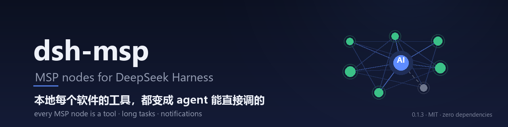

# dsh-msp

<p align="center">
  
</p>

<p align="center">
  <a href="https://github.com/hxh230802/dsh-msp/stargazers"></a>
  
  <a href="LICENSE"></a>
  <a href="https://github.com/hxh230802/dsh-msp/commits/master"></a>
  
  
  <br>
  
  <a href="https://pypi.org/project/msp-py/"></a>
  
</p>

把**本机 MSP 网络上每个节点**的工具暴露成 DeepSeek Harness 工具，agent 直接调用。

[English](README.md) | 中文

```
agent ──(DSH tool)──> dsh-msp ──(MSP/TCP, 每节点一条连接)──> gateway / notchpeninsula / …
                                                                  └─(MCP/WS)─> ESP32
```

## 装

```bash
dsh plugin --profile <profile> add /path/to/dsh-msp --ignore-workspace-root-check

# 按 tag 固定版本（除了作者本人，建议都这么装：跟分支装意味着任何提交都算已发布）
dsh plugin --profile <profile> add github:hxh230802/dsh-msp#v0.1.1 --ignore-workspace-root-check
dsh --profile <profile> --dump-config | grep -A8 'id: dsh-msp'   # 确认配置树里有这行
```

**host 侧插件，改完要重启 GUI 才生效**（刷新页面不算）。卸载：
`dsh plugin --profile <profile> remove dsh-msp`。

## 配

`cordis.patch.yml`（装成 profile 依赖后自动并进配置树）：

```yaml
- insert:
    - id: dsh-msp
      name: dsh-msp
      config:
        nodesDir: ~/.msp/nodes
        includeNodes: []        # 非空 = 只连这些节点（白名单）
        excludeNodes: []        # 黑名单，例如 [test.node1, demo_signals]
        toolPrefix: msp_
        discoveryMs: 3000       # 发现目录扫描间隔
        callTimeoutMs: 30000
        retryMs: 3000           # 单节点断开后的重拨间隔
        staleAfterMs: 30000     # 租约：超过这么久没续租的声明视为已死
        maxPeers: 16
        verbose: false
```

## 行为

- **每个节点一条连接**：按发现目录里的租约跟踪所有新鲜节点（> `staleAfterMs` 未续租
  的声明直接忽略——这就是 MSP 的"崩溃自动消失"）。
- **工具名 = `msp_<节点>_<工具>`**：节点 id 归一化成 `[a-z0-9_]`；若工具名本身已带
  该前缀则不重复拼（`notchpeninsula_hellomsp_echo` → `msp_notchpeninsula_hellomsp_echo`）。
- **断开 ≠ 摘除**：socket 断了工具仍在（否则模型手里的工具名会跳变），调用返回
  「未连接」；只有**租约过期**（节点真的没了）才摘掉那组工具。
- **清单跟随**：节点推 `MANIFEST_UPDATE`（设备上线/掉线、工具增删）时按名字 diff，
  不重启会话。
- **错误即值 → 抛错**：MSP 的 `ToolResult(error=...)` 在 DSH 侧表现为 `throw`。
- 零依赖：MSP 客户端在 `lib/msp.js` 里自带，不引 npm 包。
- **每个进程一个唯一 node id**：插件以 `dsh-msp-<8hex>` 加入网络，启动时随机生成。
  不能写死 `dsh-msp`——对端的连接表**按 node id 为键**（`connections[peer_id] = conn`），
  握手去重还按 id 比较决定方向，两个进程报同一个 id 在对端眼里就是"同一个 peer 的两条
  连接"，后连的踢掉先连的，两边都抖。两个 DSH 窗口、两个 profile、或同机再跑一个 DSH
  都会撞上。需要**稳定身份**（比如对端按 id 做白名单）时在配置里写 `nodeId`。

## 界面（client 半端）

装好并重启后，左侧栏会出现一个 **MSP** 图标，点开是一整页：

| 区块 | 内容 |
|---|---|
| **节点/工具关系图** | 中心是本插件，外围每个 CIRCLE 是一个 MSP 节点；实线 = 已连接，虚线 = 断开；圆的大小随工具数增长，圈内数字是工具数 |
| **权限与工具** | 每个节点一行：状态点、地址、启用/禁用按钮、该节点宣告的工具（含参数名，hover 看描述）。点"已启用"→ 断开该节点并摘掉它的工具 |
| **通知开关** | 三个独立开关：有操作等我确认 / 模型在问我问题 / 任务完成（仅长任务） |
| **最近调用** | 时间 / 节点 / 工具名 / 耗时或错误，来自 host 侧记录的最后 40 条 |
| **发现目录** | 声明文件里的全部节点与租约年龄（含过期未清理的） |

数据通路：host 注册三条路由，页面每 2 秒轮询一次。

```
GET  /msp/state   → { ok, peers[], calls[], discovered[], policy, notify }
POST /msp/node    → { nodeId, enabled }   改权限，立刻重连/断开
POST /msp/notify  → { key, enabled }      或 { approval|question|turnEnd: boolean }  开关通知
```

## 通知开关（用户可关）

三个场景各一个开关，面板上直接点：

| 开关 | 触发事件 | 说明 |
|---|---|---|
| 有操作等我确认 | `approval/asked` | 审批被挂起时弹 |
| 模型在问我问题 | `tools/pre-execute` 且工具是 `ask_user_question` | 弹问题原文 |
| 任务完成 | `turn/end` | 仅本轮 ≥ `turnEndMinMs`（默认 20s）时弹，避免刷屏 |

**优先级**：面板里点过的选择 > `cordis.patch.yml` 里的 `notifyOn*` 默认值。
选择落在 `~/.dsh/dsh-msp/notify.json`，重启后保持——否则每次重启都把用户关掉的
提醒又打开，开关就没意义了。文件缺失/损坏时退回默认值，不会拖垮插件启动。

通知走的是 MSP 的 `notify`：host 直接调节点，**不经过模型、不烧 token、不占回合**。

### 为什么是「公告 + 投递」两条通道

MSP 的 `signal` 是**公告**（我已经做了 X），工具是**命令**（请你做 X）。对端宣告的
信号 `notify.toast.raised` 描述是"系统通知**到达**"——过去式的观察事件，往里面
publish 等于谎报"一条 toast 已经到了"，而且接收方没有匹配 handler 时会静默丢弃
（协议如此，不向未授权对端回错）。

所以拆成两段，各用对的通道：

| 通道 | 机制 | 语义 | 谁在用 |
|---|---|---|---|
| **公告** | `publish("dsh.attention.requested")` | 发完即忘、广播、可多方订阅 | 手机推送、灯、日志、另一个 agent |
| **投递** | `callTool("notify")` | 1:1、要结果、真的弹窗 | 用户 |

```yaml
signalPath: dsh.attention.requested
useSignal: true    # 只公告：useTool: false
useTool: true      # 只投递：useSignal: false
```

公告失败不拖累投递（反之亦然）：信号是旁路，弹窗才是目的。

**图标是内联 base64**，不是运行期读文件。`lib/icon.js` 里存着 64×64 PNG 的 base64
（11.9KB），`assets/` 下保留同名 PNG 作为源图。这样做的原因：运行期读盘引入一整套
失败面——包被复制/挂载到别处、相对路径算错、Windows 上 `new URL().pathname` 给出
`/F:/...` 前导斜杠（这个坑踩过一次，图标会**静默**变成 null）。

```yaml
notifyIcon: true                    # 默认：用内联 base64
notifyIconPath: C:/path/to/x.png    # 覆盖：才去读文件，读不到自动退回内置图
# notifyIcon: false                 # 完全不带图标
```

`/msp/state` 的 `notifyIcon` 会告诉你图标从哪来：`{ok, source: "embedded"|"file"|"disabled", chars}`。

原图（源文件）：`assets/notify-icon-64.png`。MCP content 块里
`annotations.role = "icon"` 的 image 块会被对端当成通知图标（对端回报
`"icon": "内联图(N 字符)"` 即表示收到了）。换图两种方式：

```yaml
notifyIcon: true
notifyIconPath: C:/path/to/your.png   # 绝对路径覆盖内置图
# 或者 notifyIcon: false 完全不带图
```
节流默认 3 秒（同标题），节点没连上时自动找别的有 `notify` 能力的节点。

浏览器半端是手写的 CJS bundle（`lib/client.js`，`window.__ModuleLoader__.load` 包装，
`react` 由宿主 `require` 提供），**不需要构建工具链**。

## 自带工具

| 工具 | 作用 |
|---|---|
| `msp_status` | 每个节点的连接状态、端点、已暴露的工具；发现目录里的全部节点（含租约年龄）；通知开关、钩子计数、图标状态、长任务状态 |
| `msp_call_wait` | 调一个工具并等它完成：先等完成信号，信号不来则轮询状态工具兜底；窗口到期返回 `pending` 句柄 |

## 长任务（`msp_call_wait`）

模型看到的是**同步调用**，麻烦的部分在 host 里：

```
msp_call_wait {node:"gd3", tool:"add_task", args:{urls:[...]}, waitMs:25000}
  → {status:"completed", via:"signal", taskId:"tsk_…", result:{files:[…]}}     ← 窗口内完成

  → {status:"pending", taskId:"tsk_…"}                                          ← 到期未完成
```

三层，按优先级：

| 层 | 作用 | 为什么需要 |
|---|---|---|
| **完成信号**（`task.completed` 等） | 快路径，毫秒级返回 | 订阅的意义所在 |
| **轮询**状态工具（`get_task`） | 兜底 | 信号没有保留语义、可能未授权（发布方用 `grant_sub` 卡收件人）、断线期间的会丢 |
| **窗口后转后台观察** | 卡片继续活着 | 长下载不能卡住一个回合 |

因为轮询始终并行在跑，**"不知道哪条信号代表完成"是性能问题，不是正确性问题**——最坏只是慢几秒。

**绑定怎么学到**：节点的 manifest 本来就列出了信号路径，插件全部订上，再用启动工具返回的句柄去匹配观测到的 payload——第一次出现的、含该句柄的事件即确认映射，然后缓存到 `~/.dsh/dsh-msp/bindings.json`。命名启发（`completed` / `failed`）给第一次尝试做先验。**节点作者什么都不用声明。**

**窗口到期后**继续在后台观察；完成时追加一条记录（`msp_status` 可见）并复用通知通道弹一下。

注意：`gd3` 这类节点**没有进度信号**（只有 `task.added` / `status` / `completed` / `failed` / `removed`），所以进度不会流进对话——面板能看到，模型看到的是最终结果。

## 自测（不需要 DSH）

```bash
npm test                      # 单元自测：host 路由（假 req/res）+ client bundle（mock 模块加载器）
node scripts/smoke.mjs        # 假 ctx 驱动插件，对着真实 MSP 网络跑「发现→连接→注册→调用」
node scripts/probe-peers.mjs  # 只探测：逐个连上新节点，打印它们的工具/信号/能力，不注册
node scripts/call-peer.mjs <node> <tool> '{...}'   # 命令行直接调某节点的一个工具
```

## 已知边界

- 只做 `request-reply`（工具调用），**不订阅 MSP 广播**——MSP 的 `signal` 被忽略，
  所以 `notify.*`、`media.track.changed` 这类信号不会推进模型上下文。
- 工具 schema 变化但名字不变时不会重注册（避免打断会话）；节点重连才会拿到新 schema。
- 无鉴权：MSP 本机自组网的信任模型是"传输可达即信任"，跨机请自行加隔离。
